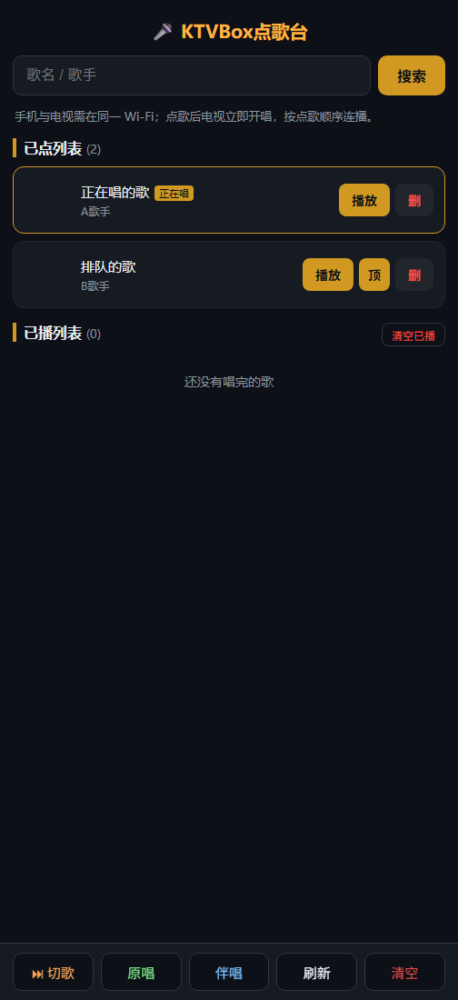

# KTVBOX 🎤

[](#install)
[](#install)
[](#features)
[](#license)

English · [简体中文](README.zh-CN.md)

**Turn any TV or projector into a karaoke machine — every phone in the room becomes a song picker. No app to install on the phone. No account. No cloud.**

| TV side (real device) | Phone side (web picker, demo data) |
|---|---|
|  |  |

**KTVBOX** is a TVBox-based karaoke app for Android TVs and projectors. The TV plays songs from your KTV spider source; everyone else just scans a QR code shown on screen and picks songs from their phone browser — queue, pin, skip, all in real time.

*Based on the TVBox (AGPL-3.0) code base; the whole KTV layer is built on top of it.*

---

## Features

### 📺 TV side

- **Singer & song search** through the spider's dedicated singer channel — unlimited results, 20 per page with paging
- **Next-song preview**: when the current song has 30 seconds left, the next song's name appears at the top of the screen (transparent, doesn't cover lyrics) for about 20 seconds
- **QR overlay**: hides itself 60 seconds after each song starts; on the home screen it jumps between the two bottom corners every 30 seconds so no single pixel area burns in
- **Queue management**: pin a queued song right after the current one, skip the current song, clear the played list
- Teal neon theme matched to the app icon

### 📱 Phone side (browser — nothing to install)

- **Pick** a song (button turns "picked" as feedback) or **pin-to-next** to jump the queue
- Aggregated search across song name and singer, star shortcuts (周杰伦 / 邓紫棋 / 林俊杰 / 告五人…)
- Manage the queue: pin / delete / clear, played history
- Works over LAN only — the phone talks to the TV's built-in web server

## Install

1. Grab the latest `TVBox_debug-armeabi-generic-java.apk` from Releases (or build it yourself below) and install it on your TV / projector
2. Set your KTV spider source in the app's config (same one TVBox uses)
3. Open KTVBOX — a QR code appears on screen; scan it with any phone

## Build

```bash
# Windows, requires JDK17 + Android SDK
gradlew assembleArmeabiGenericNormalDebug assembleArm64GenericNormalDebug
```

APKs land in `app/build/outputs/apk/{armeabiGenericNormal,arm64GenericNormal}/debug/`

## How it works

```
Phone (browser) ──HTTP──▶ TV app (built-in server :9978)
                            ├── /ktv            phone picker page (single html, no framework)
                            ├── /ktv/add        pick (auto-starts playback if queue was empty)
                            ├── /ktv/addNext    pin right after the current song
                            ├── /ktv/top        pin a queued song
                            ├── /ktv/skip       skip current
                            ├── /ktv/queue      queue JSON
                            └── /ktv/played     history
```

- Song sources come from TVBox spiders (`vod_id` format: `编号$$$歌名$$$歌手`)
- The queue is persisted on-device (Hawk)

## Project layout

```
Box/
├── app/src/main/java/com/github/tvbox/osc/
│   ├── ktv/                    ← ⭐ the KTV layer
│   │   ├── KtvActivity.java    TV home: search, queue, paging
│   │   ├── KtvApiProcess.java  search + HTTP endpoints (:9978)
│   │   ├── KtvQrOverlay.java   QR overlay (hide / corner rotation)
│   │   ├── KtvNextOverlay.java next-song preview
│   │   └── SongQueue.java      queue persistence (Hawk)
│   ├── ui/activity/PlayActivity.java   playback + skip + audio-track guard
│   └── …                       upstream TVBox code
├── app/src/main/res/raw/ktv.html       phone picker page
└── app/src/main/res/layout/activity_ktv.xml
```

## License

AGPL-3.0, inherited from the upstream TVBox project. See [LICENSE](LICENSE).

> KTVBOX is a playback front-end — song sources are provided by your own configured spider. Please respect the copyright of the content you play and use it for personal purposes.
