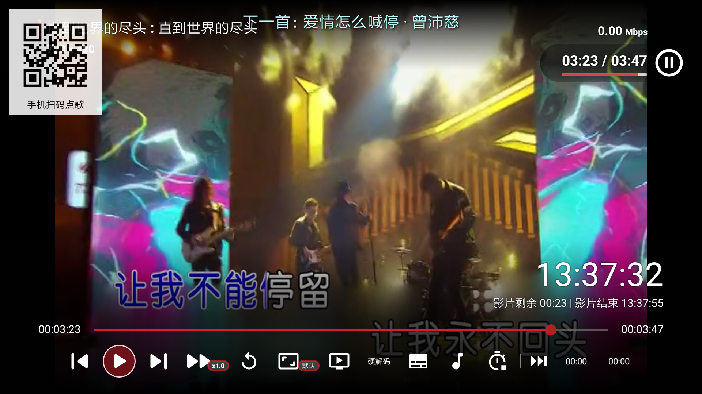
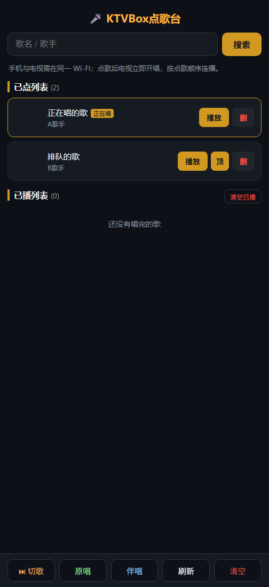

# KTVBOX 🎤

[](#安装)
[](#安装)
[](#功能特性)
[](#许可)

[English](README.md) · 简体中文

**把电视/投影仪变成点歌机——房间里每台手机都是点歌台。手机不用装 App、不用注册、不连云。**

| 电视端（真机实拍） | 手机端（点歌页示意，demo 数据） |
|---|---|
|  |  |

**KTVBOX** 是基于 TVBox（AGPL-3.0）改版的 KTV 点歌应用。电视负责放歌（歌曲源来自你配置的点歌蜘蛛），其他人扫屏幕上的二维码，用手机浏览器就能点歌、置顶、切歌，全部实时同步。

*在 TVBox 代码基础上新增了完整的 KTV 层。*

---

## 功能特性

### 📺 电视端

- **歌手/歌名搜索**：走蜘蛛源的歌手专用通道，结果无上限，20 首/页翻页
- **下一首预告**：当前歌剩 30 秒时，屏幕顶部无背景显示下一首歌名约 20 秒（不挡歌词）
- **点歌二维码浮层**：每首歌开播 60 秒后自动隐藏；主界面每 30 秒在左右下角随机换位，防止单一区域烧屏
- **队列管理**：已点歌曲置顶（排到正在唱之后）、切歌、清空已播
- teal 霓虹主题（与应用图标同色系）

### 📱 手机端（浏览器扫码即用，无需安装）

- **点歌**（成功反馈：按钮变「已点」）与**「优先」**插队（插到正在唱之后）
- 歌名/歌手聚合搜索、明星快捷位（周杰伦 / 邓紫棋 / 林俊杰 / 告五人…）
- 已点列表管理（顶 / 删 / 清空）、已播历史
- 仅走局域网——手机直连电视内置 Web 服务

## 安装

1. 从 Releases 下载 `TVBox_debug-armeabi-generic-java.apk`（或自行编译），装到电视/投影仪
2. 在 APP 配置里设置你的点歌蜘蛛源（与 TVBox 通用）
3. 打开 KTVBOX，屏幕出现二维码，手机扫码即可

## 编译

```bash
# Windows，需 JDK17 + Android SDK
gradlew assembleArmeabiGenericNormalDebug assembleArm64GenericNormalDebug
```

产物在 `app/build/outputs/apk/{armeabiGenericNormal,arm64GenericNormal}/debug/`

## 运行机制

```
手机（浏览器）──HTTP──▶ 电视 APP（内置服务 :9978）
                        ├── /ktv            手机点歌页（单 html，无框架）
                        ├── /ktv/add        点歌（队列空时自动开播）
                        ├── /ktv/addNext    优先：插到正在唱之后
                        ├── /ktv/top        已点置顶
                        ├── /ktv/skip       切歌
                        ├── /ktv/queue      队列 JSON
                        └── /ktv/played     已播历史
```

- 歌曲源为 TVBox 蜘蛛（`vod_id` 格式：`编号$$$歌名$$$歌手`）
- 队列持久化于设备本地（Hawk）

## 项目结构

```
Box/
├── app/src/main/java/com/github/tvbox/osc/
│   ├── ktv/                    ← ⭐ KTV 层
│   │   ├── KtvActivity.java    电视主界面：搜索、队列、翻页
│   │   ├── KtvApiProcess.java  搜索 + HTTP 接口（:9978）
│   │   ├── KtvQrOverlay.java   二维码浮层（隐藏/换位）
│   │   ├── KtvNextOverlay.java 下一首预告
│   │   └── SongQueue.java      队列持久化（Hawk）
│   ├── ui/activity/PlayActivity.java   播放 + 切歌 + 音轨保护
│   └── …                       上游 TVBox 代码
├── app/src/main/res/raw/ktv.html       手机点歌页
└── app/src/main/res/layout/activity_ktv.xml
```

## 许可

AGPL-3.0（继承自上游 TVBox 项目）。见 [LICENSE](LICENSE)。

> KTVBOX 只是播放前端，歌曲源来自你自行配置的蜘蛛。请尊重内容版权，仅供个人使用。
